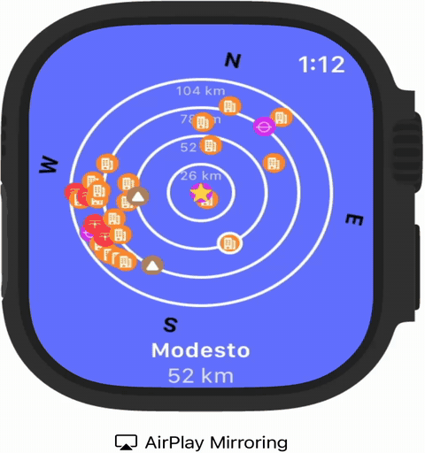
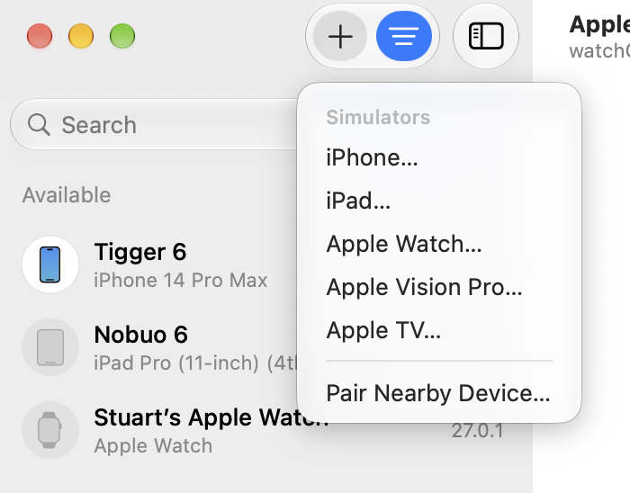

# POIView2
Stuart Rankin\
26 October 2026

## Summary
Apple Watch version of HUDView/HUDView2, with a companion iPhone app for entering places. Apple Watch does not have a camera, so only the radar display is implemented.

\
The image above is POIView2 running on my Apple Watch. I created the video by mirroring the Watch on my iPhone, then mirroring my iPhone on my Mac via QuickTime and recording the screen (for cropping purposes).

I wanted to show points of interest on my watch and have it oriented in the proper direction.

## iPhone Companion App
POIView2 is now a watchOS app with a companion iPhone app (the iPhone app embeds the watch app, so installing one installs the other).

- **Radar tab:** the same radar as the watch, larger, using the iPhone's own compass and location. Pinch or use the slider to zoom (the watch uses the Digital Crown).
- **Places tab:** enter, edit and delete your own points of interest: a name, a type (city, mountain, park, ...), a latitude and longitude (or **Use My Current Location**), and optionally an elevation and a population. They appear on the radar on both devices alongside the built-in Northern California places.
- **Sending to the watch:** every change on the iPhone is sent to the watch automatically using WatchConnectivity's application context, which always delivers the latest list, even if the watch app is not running when it is sent. The watch keeps its own copy, so the places are still there when the iPhone is not. **Send to Watch Now** resends the list. The iPhone is the only place places are edited; the built-in places are not editable.

### Project layout
- `Shared/` is compiled into both apps: the places (`POI`, `POIStore`), the radar drawing (`POIView`, `RadarContent`), the compass (`HeadingProvider`) and the iPhone-to-watch link (`WatchLink`).
- `POIView2 Watch App/` holds only what is specific to the watch (the Digital Crown zoom and the app entry point).
- `POIView2/` is the iPhone app. `POIView2Tests/` has unit tests (Swift Testing) for the place store, the editor's validation and the radar math; run them on an iPhone simulator.

## Code
I created the framework for the UI and the code. I used Claude to finish the UI and implement the plotting code. I reused code from HUDViewUI for the points of interest.

## Issues
### Debug Mode
It took me while to get my watch to recognize my Mac. It turned out to be quite straightforward but getting there was not necessarily as straightforward as I would have liked. Regardless, I got there.

#### Enabling Debug Mode
For macOS 27, Xcode 27, iOS 27, and watchOS 27, I found that if you go into the Device Hub and select **Pair Nearby Device**, your Watch will show the Debug Mode option in **General|Privacy & Security**. \

\

Prior to finding that, I spent time using AI chat bots giving old information and getting stuck in advice loops.

### Space Constraints
This is the first watchOS program I have written and the amount of space is very constrained from what I am used to. I added a feature to let the user tap on a point of interest to show the information in text form at the bottom as a way to help with understanding what the dots are.