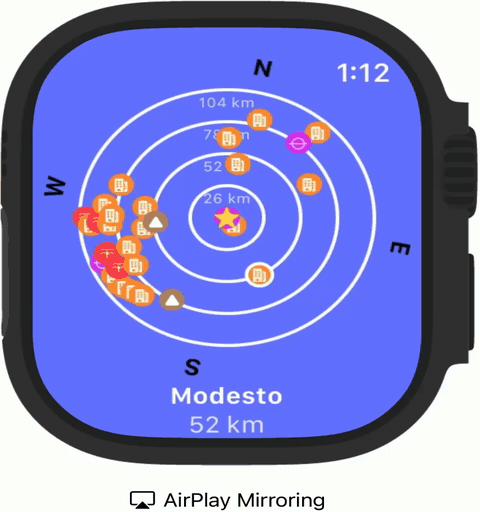
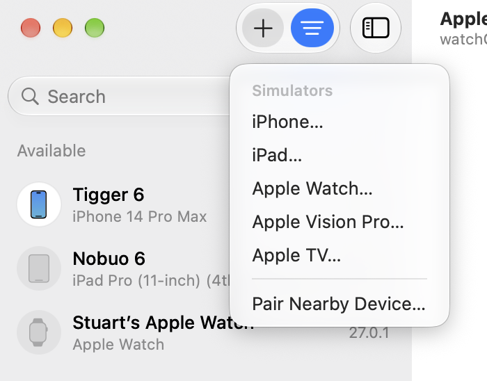

# POIView2
Stuart Rankin\
26 October 2026

## Summary
Apple Watch version of HUDView/HUDView2. Apple Watch does not have a camera, so only the radar display is implemented.

\
The image above is POIView2 running on my Apple Watch. I created the video by mirroring the Watch on my iPhone, then mirroring my iPhone on my Mac via QuickTime and recording the screen (for cropping purposes).

I wanted to show points of interest on my watch and have it oriented in the proper direction.

## Code
I created the framework for the UI and the code. I used Claude to finish the UI and implement the plotting code. I reused code from HUDViewUI for the points of interest.

## Issues
### Debug Mode
It took me while to get my watch to recognize my Mac. It turned out to be quite straightforward but getting there was not necessarily as straightforward as I would have liked. Regardless, I got there.

#### Enabling Debug Mode
For macOS 27, Xcode 27, iOS 27, and watchOS 27, I found that if you go into the Device Hub and select **Pair Nearby Device**, your Watch will show the Debug Mode option in **General|Privacy & Security**. \

\

Prior to finding that, I spent time using AI chat bots giving old information and getting stuck in advice loops.

### Space Constraints
This is the first watchOS program I have written and the amount of space is very constrained from what I am used to. I added a feature to let the user tap on a point of interest to show the information in text form at the bottom as a way to help with understanding what the dots are.